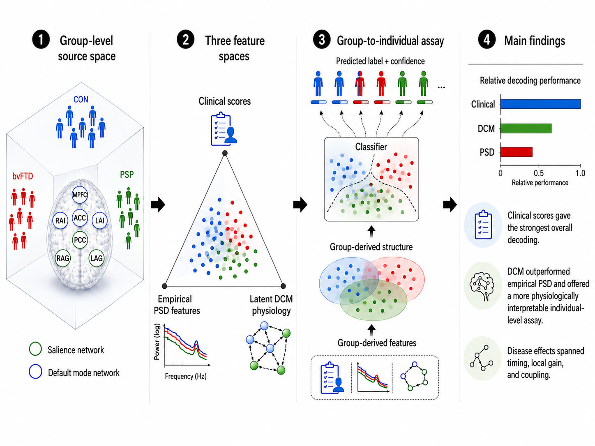
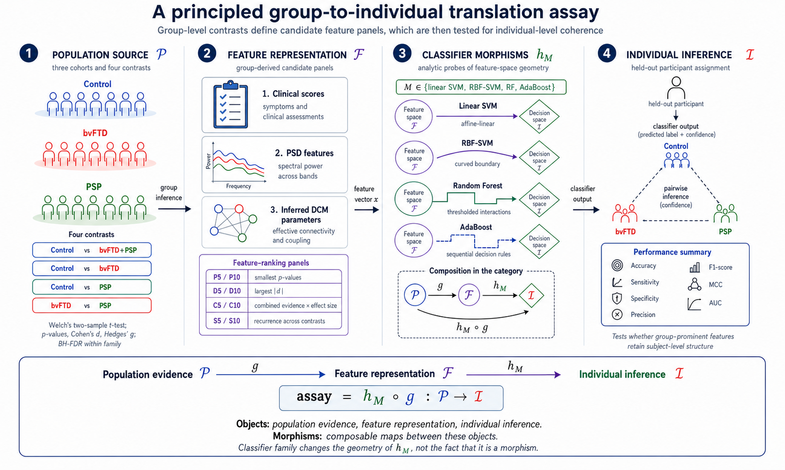

# From group-level neurophysiological biomarkers to individual-level phenotyping to identify mechanisms of neurodegenerative disease

**Amirhossein Jafarian, Laura E. Hughes, Michelle Naessens, Matthew A. Rouse, Thomas E. Cope, Negin Holland, Alexander Murley, Sean Tan Yong Wei, Timothy Rittman, David J. Whiteside, James B. Rowe**

## Study overview

This study examines how findings identified in group comparisons are expressed in individual participants. We analyse resting-state magnetoencephalography (MEG) from 74 healthy controls, 45 participants with behavioural-variant frontotemporal dementia (bvFTD), and 55 participants with progressive supranuclear palsy (PSP).

The graphical abstract brings together three complementary descriptions: clinical assessments of cognition, behaviour and motor function; empirical spectral features of neuronal activity; and physiological parameters inferred through dynamic causal modelling (DCM). Clinical measures showed the strongest individual correspondence, empirical spectral features showed weaker assignment, and DCM parameters provided an intermediate representation with physiological interpretation. Together, these approaches connect the clinical expression of disease with observed neural dynamics and candidate underlying mechanisms.



## The group-to-individual approach

The analysis starts with group comparisons. Features are ranked by statistical evidence, effect size, their combination, and recurrence across contrasts. Panels of five or ten features then represent each participant as a compact feature vector. A classifier maps that vector to a decision score and an assignment.

The figure below describes these steps as *morphisms*: mappings that connect group-level evidence, feature representation and individual assignment. Linear SVM uses an additive weighted combination of features; RBF-SVM allows curved decision boundaries; and tree ensembles combine feature-dependent rules. Their composition forms the group-to-individual assay.



The panels remain fixed while each participant is left out of classifier fitting. The resulting assignments describe correspondence within the group-defined representation. Analyses cover CON versus bvFTD, CON versus PSP, bvFTD versus PSP, and CON versus the pooled bvFTD+PSP group.

## Code folders

The MATLAB code follows the MEG analysis from preprocessing to individual assignment.

| Folder | Contents |
| --- | --- |
| [`pre_processing`](pre_processing) | MEG preprocessing, MRI-informed source inversion and source time-course extraction. |
| [`dcm`](dcm) | Seven-source cross-spectral DCM specification and participant-level model fitting. |
| [`Feature`](Feature) | Spectral feature extraction, group PSD overlays, and group comparisons of empirical features and DCM parameters. |
| [`probe_classification`](probe_classification) | P/D/C/S panel construction and leave-one-out classifier fitting for empirical and DCM features. |

The [code guide](docs/analysis_guide.pdf) explains each script, its inputs and outputs, and the order of use. Its [LaTeX source](docs/analysis_guide.tex) is included.

## Running the analysis

Use MATLAB with SPM12, OSL, Signal Processing Toolbox, and Statistics and Machine Learning Toolbox. Source inversion also uses the study helper `spm_eeg_inv_datareg_ui_ek`. Open MATLAB in the repository root and add the analysis folders:

```matlab
addpath('pre_processing', 'dcm', 'Feature', 'probe_classification');
```

Set the data locations and participant selection at the top of the relevant scripts. Participant metadata have an ID in the first column and group in the second. Use text IDs such as `Sub0001` or `sub-Sub0001`. Source files and fitted DCM files are the inputs to the downstream analyses; participant-level data are not included in this repository.

Run preprocessing and source extraction first if starting from MEG recordings. With source files already available, run the empirical branch in this order:

```matlab
Extraction_Features_optimised;
Stats_Report_From_Features;
CLASSIFY_FEATURE_TABLE_FROM_STATS_REPORT_LOO;
```

For the DCM branch, fit participant models with `DMM_run_me_2025_SNDMN`, then run:

```matlab
STAT_FIRST_LEVEL_DCM_between_groups;
CLASSIFY_ALL_DCM_REPORTS_LOO;
```

`GrandAverage_LogPSD_Overlay_withStats` produces the group spectral overlays. Downstream analysis outputs are written under `results`, with separate folders for features, group statistics, spectral plots and classification summaries.
